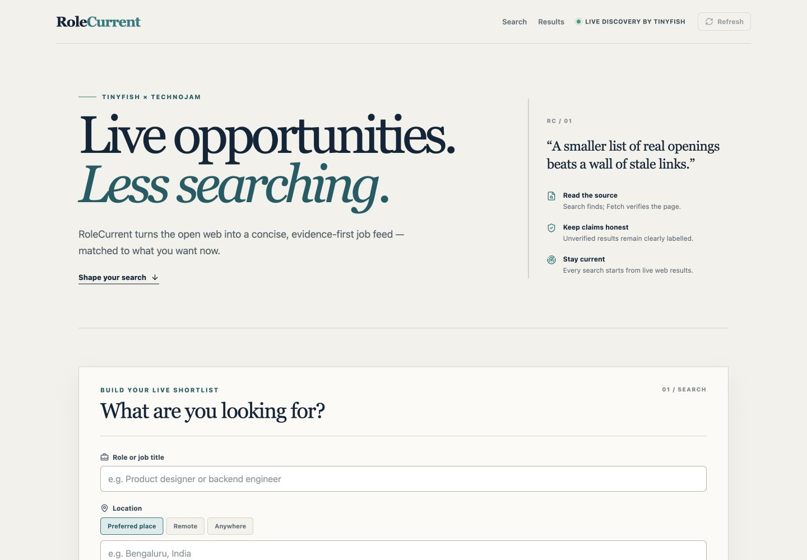
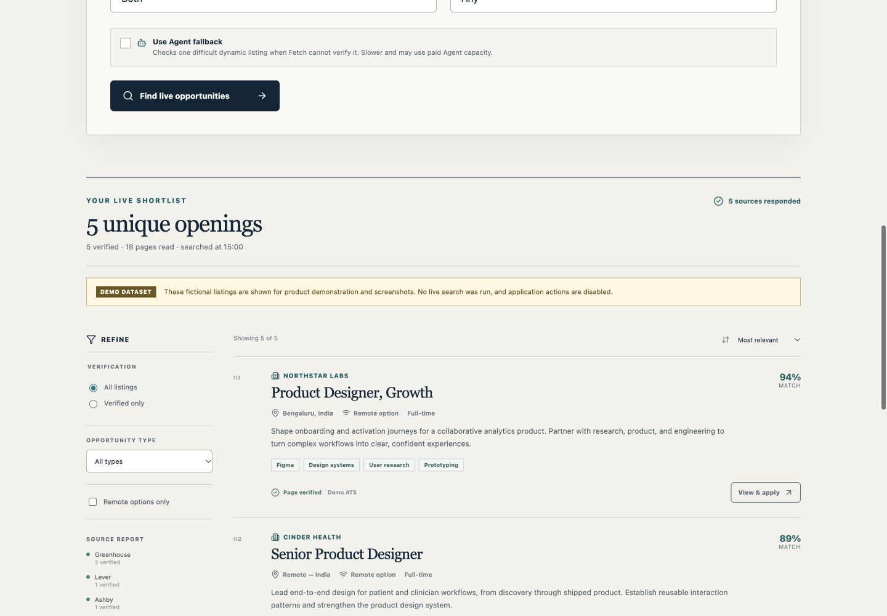
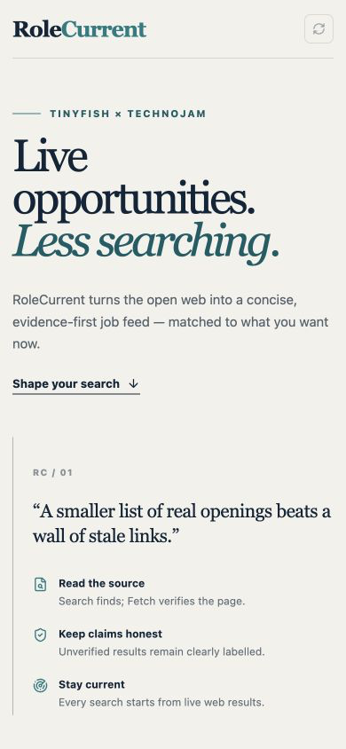

# RoleCurrent

**Live opportunities. Less searching.**

RoleCurrent is an evidence-first job discovery product built for the TinyFish × TechnoJam bounty. It searches multiple live career sources, reads individual job pages, rejects generic career hubs, deduplicates openings, and ranks the remaining roles against editable user preferences.

The previous Streamlit interface has been replaced completely. The working Python discovery logic remains server-side and now powers a React + TypeScript frontend through a small FastAPI boundary.

## Screenshots

| Main interface | Results interface |
| --- | --- |
|  |  |

### Mobile



The results screenshot uses the app's explicitly labelled fictional demo dataset. It does not represent live openings and does not consume TinyFish credits. Live searches always come from the server-side TinyFish integration.

## What it supports

- Editable role, location, remote/anywhere, skills, opportunity type, and experience preferences.
- TinyFish Search across the open web and independent ATS sources.
- TinyFish Fetch verification of exact listing pages, including honest per-URL failure handling.
- Optional TinyFish Agent fallback for one difficult dynamic listing, with structured output and failure isolation.
- URL and cross-portal deduplication, conservative listing validation, expired-deadline rejection, preference filtering, and relevance ranking.
- Direct application links, source labels, skill tags, and truthful Fetch/Agent/discovered verification states.
- Streaming progress based on completed backend work, partial-source warnings, empty results, missing-key, request-failure, and no-verified-listings states.
- Responsive, accessible React interface with no API keys in browser code.

## Architecture

```text
React + TypeScript + Vite
        │ POST /api/search (NDJSON progress stream)
        ▼
FastAPI boundary — backend/api.py
        │
        ▼
Discovery service — backend/job_service.py
        ├── TinyFish Search: live candidate URLs across several ATS sources
        ├── TinyFish Fetch: page content + per-URL errors
        └── TinyFish Agent: optional structured fallback; never blocks Search/Fetch results
```

`TINYFISH_API_KEY` is read only by the Python server. Search candidates are not treated as verified jobs until Fetch or Agent provides page evidence. Agent failures are warnings and do not discard successful Search or Fetch work.

## Local setup

Python 3.11+ and Node.js 20+ are recommended.

```bash
python3 -m venv .venv
source .venv/bin/activate
pip install -r requirements.txt

cp .env.example .env
# Add your real TinyFish key to .env

cd frontend
npm install
cd ..
```

Never commit `.env`. If a key has been exposed, rotate it in the TinyFish dashboard.

## Run in development

Use two terminals from the repository root.

```bash
source .venv/bin/activate
uvicorn backend.api:app --reload --port 8000
```

```bash
cd frontend
npm run dev
```

Open [http://127.0.0.1:5173](http://127.0.0.1:5173). Vite proxies `/api` calls to FastAPI.

## Run as one production-style app

Build the frontend, then start the Python entrypoint. FastAPI serves `frontend/dist` and the API on the same port.

```bash
cd frontend
npm run build
cd ..
source .venv/bin/activate
python app.py
```

Open [http://127.0.0.1:8000](http://127.0.0.1:8000).

## Verification

```bash
source .venv/bin/activate
python -m unittest discover -s tests -v

cd frontend
npm run build
```

Recommended demo checks:

1. Search a specific role in a city with two or three skills.
2. Repeat with Remote and then Anywhere to demonstrate editable preferences.
3. Show that multiple ATS sources report independently and that a failed source does not clear collected results.
4. Compare verified and discovered labels, then use the “Verified only” filter.
5. Enable Agent fallback only for a deliberate deep-verification demo; it is slower and may consume paid Agent capacity.
6. Open an original application URL to demonstrate that cards link to individual listings, not career homepages.

For screenshots or presentations without calling TinyFish, open `http://127.0.0.1:8000/?demo=results`. This route uses clearly labelled fictional data, disables its application actions, and never sends a search request.

Current validation: **10 backend/API tests passing** and a successful Vite production build.

## Honest limitations

- Verification is intentionally conservative and can miss a valid role when an employer blocks anonymous reading or uses an unsupported career system.
- “Discovered” means Search found an individual-looking ATS URL but the page was not verified during that run. The UI never presents it as verified.
- Agent fallback inspects at most one difficult candidate per search to control latency and cost.
- Job status can change after a search. Applicants should confirm final details on the employer page.

## Announcement drafts

Ready-to-post versions and screenshot ordering are also available in [`docs/social-posts.md`](docs/social-posts.md).

### LinkedIn

I built **RoleCurrent** for the TinyFish × TechnoJam bounty — an evidence-first job discovery product that turns live web results into a concise, preference-matched shortlist.

RoleCurrent uses TinyFish Search to discover individual openings across multiple ATS sources, Fetch to read and verify the actual listing pages, and an optional Agent fallback for difficult dynamic pages. It deduplicates cross-portal listings, preserves results when one source fails, and labels every verification state honestly.

The result: live opportunities, less searching — with direct application links and no invented roles or fake metrics.

Built with React, TypeScript, FastAPI, and TinyFish. @TinyFish

#TinyFish #TechnoJam #AIEngineering #JobSearch #BuildInPublic

### X

Built RoleCurrent for the TinyFish × TechnoJam bounty: live job discovery without the noisy job-board wall.

TinyFish Search finds exact openings → Fetch verifies real listing pages → optional Agent fallback handles difficult pages. Then RoleCurrent dedupes, filters, ranks, and links straight to the application.

Live opportunities. Less searching. @Tiny_Fish
